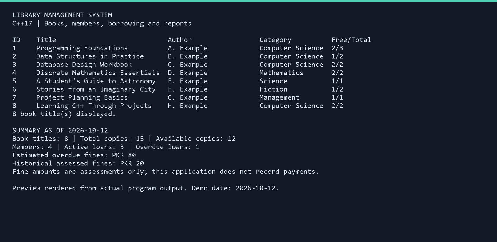

# Library Management System - C++

A C++17 console application for managing books, members, and borrowing records. Includes persistent storage, copy availability, renewals, due dates, overdue fines, search, and CSV reports.




## Features

| Area | Features |
| --- | --- |
| Books | Add, edit, list, search, and delete; multiple copies; automatic availability |
| Members | Register, edit, list, search, and delete; view borrowing history |
| Circulation | Issue, return, renew, active loans, and full history |
| Rules | Five active loans per member; prevent duplicate borrowing; prevent borrowing unavailable copies |
| Dates and fines | 14-day loans; one 14-day renewal; overdue reports; PKR 10 per overdue day |
| Reports | Dashboard, member history, overdue list, and three CSV exports |
| Storage | Save after confirmed changes; stable ID counters; backup of the previous database |
| Validation | Strict whole-number input, field length checks, graceful end-of-input, and database integrity checks |

## Included demo data

The repository includes **8 fictional book titles, 15 copies, 4 fictional members, and 4 loans** in `data/library.db`. Three loans are active and one is returned. Contacts use reserved `example.com` addresses.

For a repeatable demonstration, use `--today 2026-10-12`. On that date:

- 12 copies are available.
- One active loan is overdue, with an estimated fine of PKR 80.
- A returned loan has a final assessed fine of PKR 20.

Omit `--today` for normal use; the program uses your computer's local date. The demo data has fixed dates, so overdue amounts change over time.

## Quick start on Windows

Requirements for building: GCC/MinGW-w64 with C++17 support. A VS Code extension is not a compiler. The supplied scripts detect `g++` on PATH or the standard MSYS2 UCRT64 location `C:\msys64\ucrt64\bin`.

1. Extract the entire project into a writable folder.
2. Double-click `build.bat` to compile.
3. Double-click `run.bat` to start.

`run.bat` builds if the executable is missing. Run `build.bat` again after editing the source. Close the running application before rebuilding.

The download bundle contains two folders: `github-source` with uploadable source files, and `windows-app` with the same files plus `build/library.exe`. That executable is statically linked with the GCC runtime and can be started through `run.bat` without installing GCC. The `github-source` folder excludes compiled executables.

### VS Code

Open the **project folder**, not just `main.cpp`. The included `.vscode` settings support the standard MSYS2 UCRT64 installation on Windows:

- **Ctrl+Shift+B**: build and run in the terminal.
- **F5**: build and debug using GDB.

If your compiler is elsewhere, adjust the Windows compiler path in `tasks.json` and the compiler/debugger paths in `settings.json` and `launch.json`.

### Build manually

Windows PowerShell, from the project folder:

```powershell
New-Item -ItemType Directory -Force build
g++ -std=c++17 -Wall -Wextra -Wpedantic -O2 main.cpp -o build/library.exe
.\build\library.exe
```

Linux/macOS with GCC (9 or newer recommended) or a compatible Clang installation:

```sh
mkdir -p build
g++ -std=c++17 -Wall -Wextra -Wpedantic -O2 main.cpp -o build/library
./build/library
```

These commands require the compiler and its runtime to be on PATH. Windows GCC compilation and execution were tested; other platforms have not been tested in this environment.

Optional CMake build:

```sh
cmake -S . -B build
cmake --build build
```

Run the resulting executable from the project root so that it finds `data/library.db`. With multi-configuration generators, the executable may be in `build/Debug` or `build/Release`.

## Using the program

```text
1. Books
2. Members
3. Issue / return / renew
4. Reports
0. Exit
```

Each section has its own numbered menu. Choose `0` to return to the main menu, then `0` again to exit.

### Example: issue and return

1. Choose Books -> List to find a book ID and its available copies.
2. Choose Members -> List to find a member ID.
3. Choose Issue / return / renew -> Issue; enter the member ID, then book ID, and confirm.
4. Note the new **loan ID**. Returns and renewals use the loan ID, not the book ID.
5. Return through Issue / return / renew -> Return and confirm.

Search is case-insensitive and matches partial title, author, category, member name, contact, or ID text. Edit actions ask you to re-enter all fields and confirm before saving. Book copy counts cannot be reduced below the number currently borrowed.

## Borrowing and fine rules

- Each loan represents one physical copy of a book title.
- A member may hold at most five active loans and cannot borrow the same title twice at once.
- Loans are due 14 calendar days after issue. Returning on the due date has no fine.
- One renewal adds 14 days to the existing due date; overdue loans cannot be renewed.
- Each overdue calendar day incurs PKR 10. Active-loan fines are estimates; returned-loan fines use the recorded return date.
- Fine amounts are **assessments only**. This application does not collect money or record payments.
- Book/member records with any loan history cannot be deleted, preserving references in historical records.
- IDs remain stable and their counters are saved, including after deletion and restart.

Policy constants are near the top of `main.cpp`. Changing them can affect validation of existing records and historical fine calculations, so use a fresh demo database when experimenting.

## Data, backups, and privacy

All related records are stored together in `data/library.db`. Quoted text supports spaces, quotation marks, and backslashes. The application validates IDs, references, copy counts, and dates when loading. If the database is invalid, it stops rather than silently discarding records.

Each change is written to a temporary file, with the previous database copied to `library.db.bak` before replacement. Memory is updated only after the save succeeds. This is a simple recovery scheme, **not a crash-proof database transaction**. Run only one application instance against a given data file.

To recover: stop the application, preserve the damaged file elsewhere, and copy a known-good `library.db.bak` back to `library.db`. A backup contains the previous successful state, so the most recent change may not be included.

Start with an empty private collection using:

```powershell
.\build\library.exe --data data/private-library.db
```

Private databases named `data/private*.db`, backups, temporary files, and generated exports are ignored by Git. **The demo `data/library.db` is intentionally included.** Do not commit it after replacing fictional members with real personal data.

CSV reports are written into `exports` beside the selected database. Existing CSV reports require confirmation before replacement. Reports include member contact information; review them before sharing.

## Command-line options

| Option | Purpose |
| --- | --- |
| `--help` | Show usage |
| `--data PATH` | Use a different database; creates one on the first successful change |
| `--today YYYY-MM-DD` | Use a fixed date for demos and tests |

Supported dates: 1900-01-01 through 2200-12-31. An operation that would create a date outside that range is rejected. A relative data path is resolved from the working directory.

## Project files

| File/folder | Purpose |
| --- | --- |
| `main.cpp` | Complete commented application |
| `data/library.db` | Fictional demonstration database |
| `tests/test_app.py` | Automated integration tests using temporary data |
| `docs/demo-preview.png` | Terminal-style preview rendered from actual program output |
| `docs/demo-output.txt` | The captured output used for the preview |
| `build.bat`, `run.bat` | Windows helpers |
| `.vscode/` | Build/run/debug configuration |
| `CMakeLists.txt` | Optional CMake build |

## Tests

Python 3 is needed only for tests. Build the program first, then run:

```powershell
python tests/test_app.py build/library.exe
```

On Linux/macOS, use `python3 tests/test_app.py build/library`.

The 13 integration tests cover demo reports, search, add/edit/persistence, availability, duplicate borrowing, borrowing limits, cancellation, ID stability, deletion protections, strict input, end-of-input, invalid databases, save failure rollback, CSV escaping, renewals, overdue fines, and leap-year date arithmetic. Tests use disposable data; they do not modify the included demo database.

## Learning notes

Read `Book`, `Member`, and `Loan` first, then the `Database` structure. Follow an issue operation from input validation through the candidate copy, save, and final commit. Public record fields keep the examples readable; `Library` and `Date` encapsulate application behavior and date calculations.

This version is intended for a small, local library learning project. It does not include authentication, concurrent users, barcode hardware, reservations, notifications, payment tracking, or encrypted storage. Dates, policy checks, file safety, and input validation are included, but it is not presented as production institutional software.


